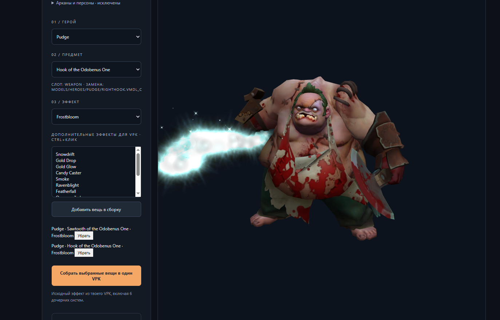
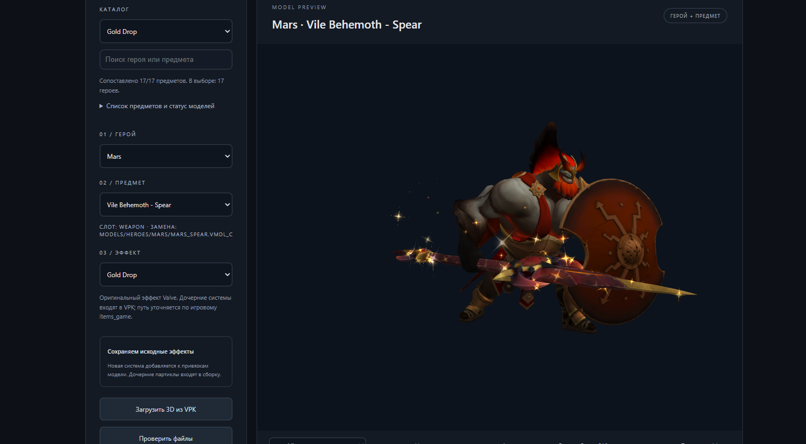

<div align="center">

# Dota Effect Studio

**Выбери героя. Собери комплект. Добавь эффекты. Скачай VPK.**


[Открыть сайт](https://harlordleg.github.io/Effect-studio/) · [Сообщить о баге](https://github.com/HarlordLeg/Effect-studio/issues)

</div>

> **Проект в бете.** Возможны ошибки моделей и эффектов. Если нашли проблему, создайте issue: укажите героя, предмет, эффект и приложите скриншот или видео.

Dota Effect Studio — приложение для подготовки косметических замен Dota 2. Выбирай предметы и эффекты, рассматривай персонажа в 3D и собирай один VPK из нескольких вещей. Доступны локальное приложение для Windows и веб-интерфейс.

## Скриншоты

**Pudge: выбор предмета, Frostbloom и корзина комплекта.**



**Mars: предпросмотр героя и эффекта Gold Drop.**



## Возможности

- Каталог героев, предметов и эффектов с поиском; игровые ресурсы берутся из установленной Dota 2.
- Предпросмотр полного персонажа: базовая модель, базовые вещи свободных слотов и выбранные косметические предметы.
- Корзина комплекта: несколько вещей и несколько эффектов на одной вещи.
- Совместный предпросмотр вещей текущего героя из корзины.
- Свой браузерный WebGL2-рендерер с анимациями и симуляцией частиц.
- Камера с управлением мышью и WASD.
- Постоянный кеш экспортированных моделей; временные сцены и эффекты очищаются отдельно.
- VPK с заменой базовых ресурсов в `models/heroes/...` и переносом зависимостей эффектов в `harlord/...`.
- Номер выходного файла от `pak01_dir.vpk` до `pak99_dir.vpk`.
- Перенос доступных ресурсных замен Immortal: частиц, моделей и иконок. Замены событий и activity-имён могут потребовать отдельной поддержки.
- Изменение цвета courier-эффектов для предпросмотра и сборки.
- Веб-виджет с сайтовыми ключами, разрешёнными origins и лимитами запросов на сборку/экспорт.
- Админка с тремя постоянными счётчиками.

Арканы и персоны исключены из обычного подбора эффектов: их модели и анимации могут быть несовместимы с базовым комплектом героя.

## Эффекты

| Группа | Эффекты |
|---|---|
| Сезонные | Frostbloom, Snowdrift, Gold Drop, Gold Glow, Candy Caster, Smoke, Ravenblight, Featherfall |
| Courier | Lava, Bleak Hallucination, Desert Sands, зимний Frostivus Frost |
| Дополнительный стиль | Diretide — призрачный стиль |

Доступность комбинаций зависит от каталога и подключённых игровых файлов. Некоторые эффекты применяются к выбранной вещи; courier-эффекты — ко всему персонажу, даже когда выбраны для отдельной вещи. Для одного героя одинаковый courier-эффект в комплекте не дублируется.

У Lava базовый цвет предпросмотра — огненно-оранжевый. Этот цвет сам по себе не перекрашивает исходные игровые частицы в VPK. Переключатель собственного цвета задаёт явное переопределение.

## Как пользоваться

1. Открой сайт или локальное приложение.
2. Выбери героя и предмет, затем основной эффект.
3. При необходимости добавь дополнительные эффекты: `Ctrl` + клик по списку.
4. Добавь вещь в сборку. Повтори для других предметов.
5. Проверь комплект в 3D. Вещи другого героя отображаются при выборе этого героя.
6. Выбери номер VPK и нажми сборку выбранных вещей.
7. Скачай архив после завершения сборки.

Вещь в уже занятом слоте заменяет предыдущую вещь этого героя. Выбранный номер меняет имя выходного файла, а не внутренние пути моделей и частиц.

| Управление | Действие |
|---|---|
| Мышь | Вращение камеры |
| Колесо мыши | Приближение и отдаление |
| `W`, `A`, `S`, `D` | Перемещение камеры |
| `Q`, `E` | Изменение высоты |
| `Shift` | Ускоренное перемещение |


## Сборка из исходников

Для разработки нужны **Node.js 24**, **.NET SDK 10** и Windows x64. Проекты C# используют ValveResourceFormat для чтения и экспорта ресурсов Source 2.

```powershell
npm install
npm test
.\build-patcher.bat
.\build-assets.bat
.\configure-dota.bat
npm start
```

Для Electron:

```powershell
npm run desktop
```

Для создания портативной папки после сборки нативных утилит:

```powershell
node tools/package-windows.mjs
```

Результат находится в `dist/DotaEffectStudio`. 

## Ограничения беты

- Предпросмотр частиц приближённый: поддерживаются не все операторы и игровые материалы Source 2.
- Внешний вид эффекта в браузере может отличаться от Dota 2, особенно у сложных courier-эффектов.
- Отдельные модели могут иметь ошибки привязки оружия, материалов или анимаций.
- Арканы, персоны и несовместимые варианты не входят в обычный каталог эффектов.
- Сборки выполняются по одной; при занятом сервере может потребоваться повторить запрос.
- Некоторые ресурсные замены Immortal переносятся, но строковые события/activities не гарантируются.
- Готовые модификации нужно проверять в игре. Загрузка VPK и поведение эффектов после превращений/заклинаний зависят от ресурсов и игрового клиента.

## Если что-то не работает

| Проблема | Что проверить |
|---|---|
| Локальная страница не открывается | Запущен ли `start-local.bat`; нет ли ошибки в консоли |
| Порт 8787 занят | Не запущен ли второй экземпляр сервера |
| Модель не загружается | Путь к Dota 2 и доступность игровых VPK |
| CRC не совпадает | Перезапустить приложение после обновления Dota; при сохранении ошибки проверить файлы игры |
| Эффект отличается от игры | Предпросмотр находится в бете и поддерживает не все операторы частиц |

## Структура проекта

| Каталог / файл | Назначение |
|---|---|
| `public/` | Редактор, собственный 3D-рендерер, частицы и админка |
| `lib/` | VPK, сборка, каталог, предпросмотр, сессии и статистика |
| `asset-bridge/` | C#-экспорт моделей и ресурсов для предпросмотра |
| `patcher/` | C#-патчер моделей и перенос ссылок ресурсов |
| `tools/` | Настройка, сборка и упаковка |
| `tests/` | Проверки Node.js и C# |
| `licenses/` | Уведомления о лицензиях зависимостей |
| `server.mjs` | HTTP-сервер приложения |
| `desktop.cjs` | Оболочка Electron |

## Тесты

```powershell
npm test
dotnet run --project tests/ModelKeyText.Tests.csproj -c Release
```

## Ресурсы и лицензии

Браузерный рендерер реализован внутри проекта. Для работы с форматами Source 2 используется ValveResourceFormat; его MIT-лицензия и уведомления о сторонних компонентах сохранены в [licenses/VRF-MIT.txt](licenses/VRF-MIT.txt) и [licenses/VRF-THIRD_PARTY_NOTICES.txt](licenses/VRF-THIRD_PARTY_NOTICES.txt).

Игровые модели, текстуры и частицы принадлежат их правообладателям. Для основного каталога используются файлы установленной Dota 2. Проект не связан с Valve Software и не является официальным продуктом Valve.

